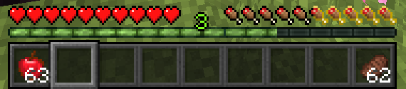
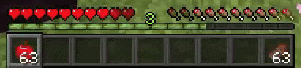

This project is abandoned. I am no longer interested in it. You can do whatever you want with these mods, I do not care.

# AppleSkin (Horizon native mod)


**Port of AppleSkin for Horizon.** Based on [AppleSkin](https://github.com/squeek502/AppleSkin) by squeek502.




## What it does

Draws the hunger details that AppleSkin shows over the food bar:

- **Saturation icons**: how much saturation you have, shown as food icons over the food bar.
- **Exhaustion strip**: a thin bar showing how close you are to the next point of food loss.
- **Held food preview**: the food in your hand, with how much food and saturation it restores.
- **Animation**: fade in, pulse, or both (default).

Each part can be switched on or off, and the animation can be changed, in the native mod settings.

## Build

```sh
horizon-launcher native-build . --trust-native-code
```

## Credits

- AppleSkin by [squeek502](https://github.com/squeek502/AppleSkin).

## License

See [LICENSE](LICENSE).
