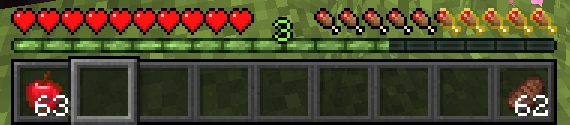
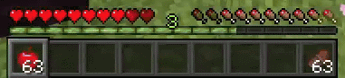

# AppleSkin (Horizon native mod)


A native mod for Horizon that draws saturation, exhaustion and the food in your hand over the food bar,
as the original [AppleSkin](https://github.com/squeek502/AppleSkin) does.




## Build

```sh
horizon-launcher native-build . --trust-native-code
```

## Credits

Based on AppleSkin by squeek502. See [LICENSE](LICENSE). for the licence notices.
